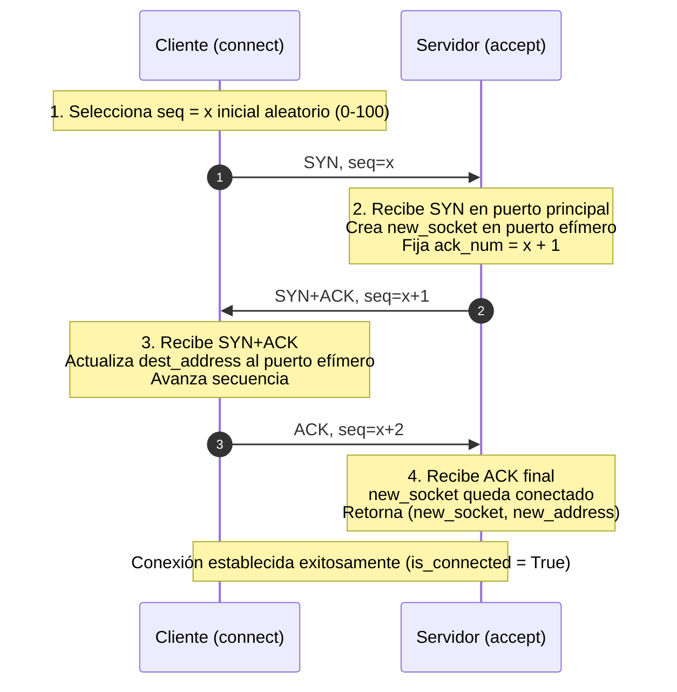
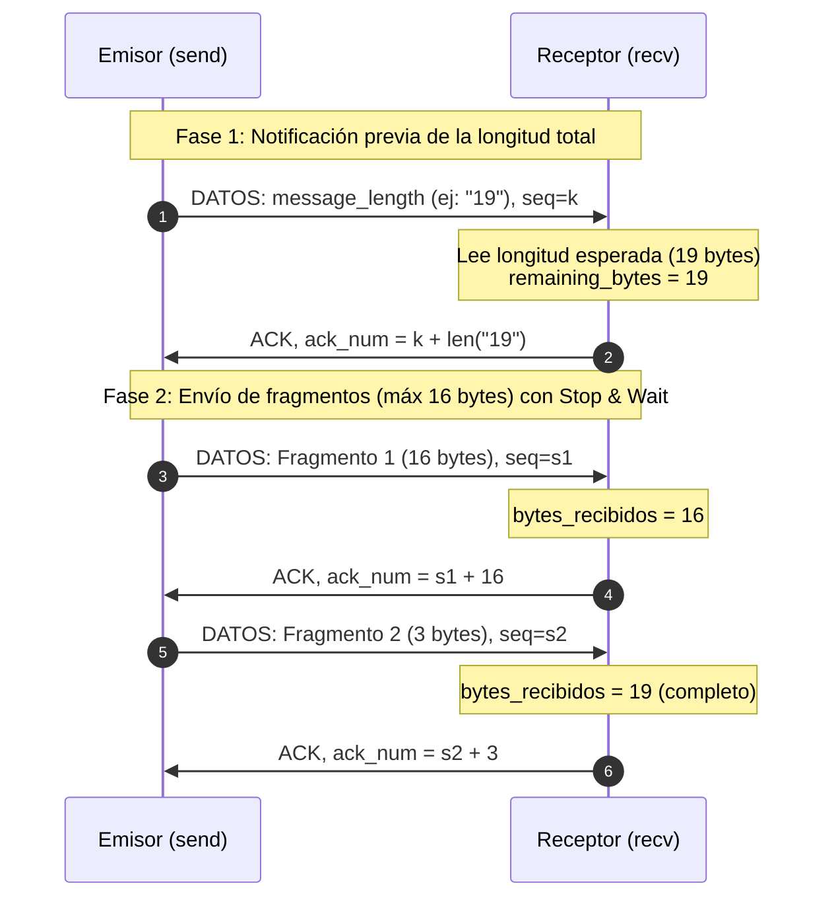
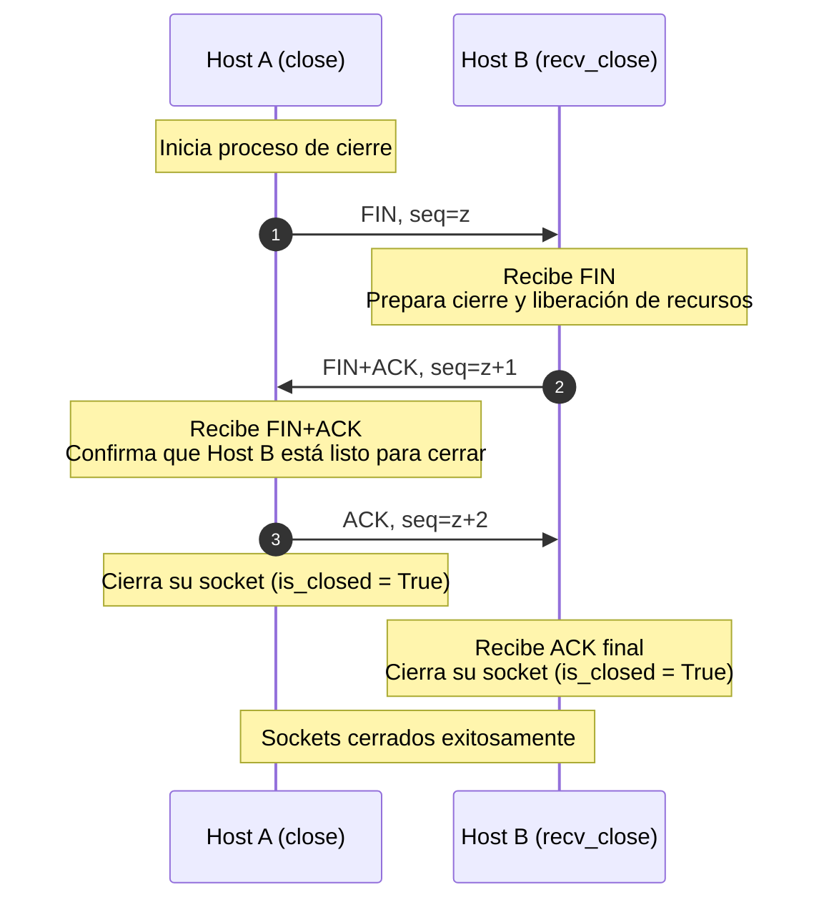
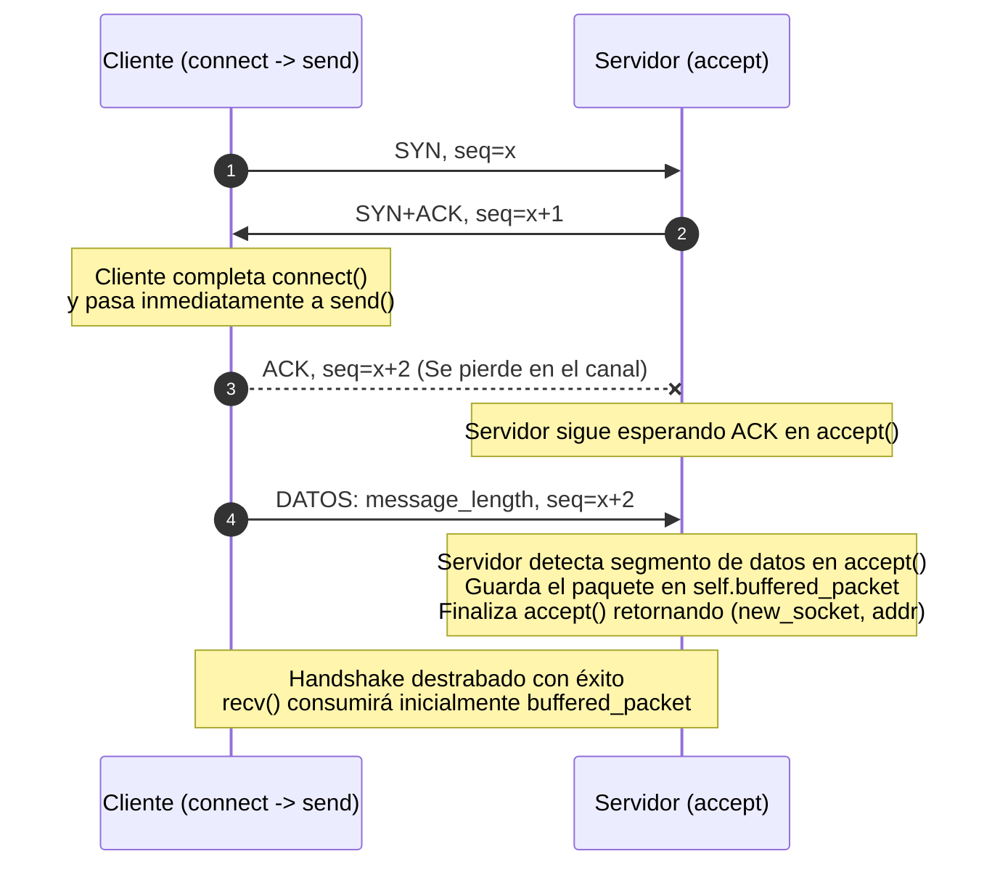
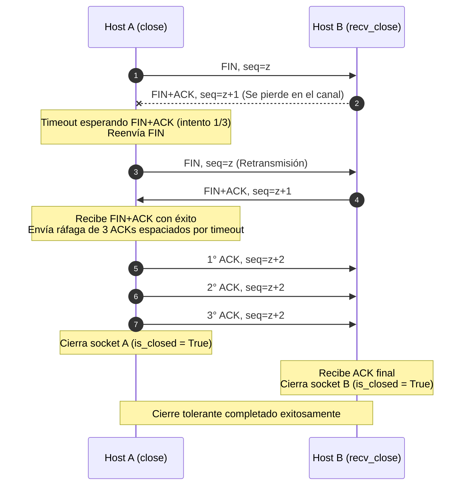

# Control 02
## Actividad-03-StopAndWait: Sockets orientados a conexión con Stop & Wait

- **Integrantes:** Bastián Arias y Tomás León
- **Repositorio:** https://github.com/Bastian-AAI/CC4303-Redes/tree/C2/Actividad-03
- **Archivo principal:** `Actividad-03-StopAndWait/SocketTCP.py`
- **Informe:** `Actividad-03-StopAndWait/README.md`

### 1. Descripción de la Solución e Implementación

En esta actividad implementamos la clase `SocketTCP` en Python. El objetivo fue crear una capa orientada a conexión y confiable sobre sockets UDP, utilizando el protocolo de control de flujo y errores **Stop & Wait**.

El código se encuentra en `SocketTCP.py` y permite realizar el saludo inicial, transferir datos divididos en paquetes pequeños y cerrar la conexión limpiamente.

#### 1.1. Diseño de los Headers TCP

Para que cada paquete UDP transporte la información de control necesaria, le agregamos un encabezado de **11 bytes fijos** antes de los datos:

- Usamos el formato `!II???` del módulo `struct` de Python:
    - `seq` (4 bytes): Número de secuencia del paquete.
    - `ack_num` (4 bytes): Número de reconocimiento que confirma qué datos esperamos.
    - `syn` (1 byte): Bandera para iniciar conexión.
    - `ack` (1 byte): Bandera para indicar que el paquete lleva una confirmación.
    - `fin` (1 byte): Bandera para solicitar el cierre de la conexión.
- **Datos:** Hasta 16 bytes por paquete.
- Implementamos las funciones estáticas `create_segment` (diccionario -> bytes) y `parse_segment` (bytes -> diccionario) para empaquetar y desempaquetar fácilmente.

#### 1.2. Establecimiento de Conexión: 3-Way Handshake

La conexión se establece mediante un saludo de 3 vías implementado en las funciones `connect(address)` del cliente y `accept()` del servidor:

1. **Cliente (`connect`):** Selecciona un número de secuencia inicial aleatorio (entre 0 y 100) y envía un paquete `SYN, seq=x` hacia la dirección de escucha (`bind`) del servidor.
2. **Servidor (`accept`):** Al recibir el `SYN`, crea una nueva instancia de `SocketTCP` en un puerto efímero asignado por el sistema operativo (`bind(('', 0))`). Desde este nuevo socket responde con `SYN+ACK, seq=x+1` (y confirmando `ack_num = x + 1`).
3. **Cliente (`connect`):** Al recibir el `SYN+ACK`, actualiza su dirección de destino (`self.dest_address`) hacia el nuevo puerto efímero del servidor y envía el paquete final `ACK, seq=x+2`.
4. **Servidor (`accept`):** Recibe el `ACK` final, marca la conexión como establecida (`is_connected = True`) y retorna `(new_socket, new_address)`.

##### Diagrama del 3-Way Handshake:



#### 1.3. Transferencia de Datos con Stop & Wait

Implementamos `send(message)` y `recv(buff_size)` con las siguientes decisiones de diseño:

- **Aviso de longitud previa:**
    Para que el receptor sepa exactamente cuánto esperar y no se quede pegado, el primer paquete enviado contiene únicamente el largo total del mensaje en bytes. El receptor lee este tamaño, responde con un ACK y fija cuántos bytes espera recibir.
- **Fragmentación a 16 bytes:**
    El mensaje se divide en trozos de a lo más 16 bytes. Cada trozo se envía con Stop & Wait: se manda el paquete, se activa un timeout y, si no llega el ACK a tiempo, se retransmite.
- **Manejo del búfer en `recv`:**
    Como el usuario puede llamar a `recv(buff_size)` pidiendo un tamaño diferente a 16 bytes (por ejemplo, `recv(14)`), creamos un búfer interno en memoria (`self.recv_buffer`). `recv` recibe paquetes de la red hasta acumular los bytes que pide el usuario, le entrega exactamente esa cantidad y guarda el sobrante en el búfer para la próxima llamada a `recv`.
- **Continuidad de secuencias:**
    Al iniciar `send` no reinicia la secuencia en 0, sino que utiliza como número de secuencia inicial el último `seq` almacenado tras el handshake, garantizando la continuidad de la numeración a lo largo de toda la conexión.

##### Diagrama de Transferencia de Datos con Stop & Wait (`send` y `recv`):



#### 1.4. Fin de Conexión

Para el cierre implementamos `close()` en el Host A y `recv_close()` en el Host B:
- El Host A envía un paquete `FIN, seq=z`.
- El Host B responde con un paquete combinado `FIN+ACK, seq=z+1`.
- El Host A responde con el `ACK, seq=z+2` final y ambos extremos cierran sus sockets liberando recursos.

##### Diagrama de Cierre de Conexión:



### 2. Instrucciones de Ejecución

#### 2.1. Cómo ejecutar los Tests de la Actividad (`server_test.py` y `client_test.py`)

Estos scripts prueban automáticamente el handshake, los 3 casos de envío/búfer (16 bytes, 19 bytes y lectura fragmentada con `buff_size = 14`), y el cierre ordenado.

Abre **dos terminales** en la carpeta `Actividad-03-StopAndWait/`:

- **Terminal 1 (Servidor):**
    ```bash
    python3 server_test.py
    ```
- **Terminal 2 (Cliente):**
    ```bash
    python3 client_test.py
    ```

**Salida esperada:**
En la Terminal 1 verás que los 3 tests pasan exitosamente (`Passed`) y la conexión se cierra de forma limpia.

#### 2.2. Cómo ejecutar el Test de Búfer no múltiplo de 16 (`buffer_test.py`)

Este test evalua el manejo del buffer en `recv()` cuando `buff_size` no es múltiplo de 16. Envía un mensaje de $2n = 26$ bytes y realiza dos lecturas consecutivas con `recv(n=13)`.

```bash
python3 buffer_test.py
```

#### 2.3. Cómo ejecutar la Transferencia de Archivos (`servidor.py` y `cliente.py`)

Para probar la transferencia real de archivos con redirección de entrada/salida:

- **Terminal 1 (Servidor):**
    Inicia el servidor escuchando en el puerto 8000:
    ```bash
    python3 servidor.py localhost 8000 > recibido.txt
    ```
- **Terminal 2 (Cliente):**
    Envía el archivo a través del cliente:
    ```bash
    python3 cliente.py localhost 8000 < archivo_prueba.txt
    ```
- **Verificación:**
    Puedes comprobar que el archivo llegó 100% íntegro comparándolo:
    ```bash
    diff archivo_prueba.txt recibido.txt
    ```

#### 2.4. Cómo activar el Modo Debug y Simular Pérdidas

Existen dos formas de probar bajo condiciones de pérdida de paquetes:

- **Opción A:**
    En `SocketTCP.py`, cambia los valores de las variables de clase:
    ```python
    # Modo Debug
    SocketTCP.debug = True
    # Simular pérdidas de paquetes
    SocketTCP.loss_rate = 0.2
    ```
- **Opción B:**
    Para inducir pérdidas a nivel del sistema operativo en `localhost`:
    ```bash
    # Activar 20% de pérdida y 100ms de delay
    sudo tc qdisc add dev lo root netem loss 20% delay 100ms

    # Desactivar al terminar las pruebas
    sudo tc qdisc del dev lo root netem
    ```

### 3. Manejo de Pérdidas y Casos Borde

#### 3.1. Caso Borde: Pérdida del Último ACK del Handshake

##### ¿Qué sucede?
Cuando el cliente recibe el `SYN-ACK`, considera que la conexión ya está establecida, envía su `ACK` final y pasa de inmediato a llamar a `send()`. Si ese último `ACK` se pierde en la red:
- El servidor se queda esperando en `accept()`.
- El cliente ya está en `send()` enviando el primer paquete de datos.

##### Diagrama del Caso Borde:



##### Solución Implementada:
- **En el servidor (`accept`):** Si mientras espera el ACK final en `accept()` le llega un paquete con datos del cliente, el servidor entiende que el cliente ya consideró la conexión abierta (porque el cliente solo envía datos si ya recibió el SYN-ACK). El servidor guarda ese paquete en una variable temporal (`self.buffered_packet`) y da por terminado el handshake. Cuando luego se llama a `recv()`, consume primero esos datos guardados.
- **En el cliente (`send`):** Si mientras espera el ACK de sus datos recibe un `SYN-ACK` repetido del servidor, le reenvía el ACK del handshake para destrabarlo.

#### 3.2. Manejo de Duplicados en `recv`

Si se pierde un ACK enviado por el receptor, el emisor agotará su timeout y reenviará el mismo paquete de datos. En `recv()` comprobamos si `seg['seq'] < self.ack`:
* Si es un paquete repetido, no lo volvemos a meter al búfer de datos para no corromper el archivo.
* Simplemente le reenviamos el ACK al emisor para que sepa que ya lo tenemos y pueda avanzar.

#### 3.3. Cierre Tolerante a Pérdidas

Para que el cierre no se quede pegado si se pierden paquetes:
- **En `close()`:** Si no llega el `FIN+ACK` dentro del timeout, reenvía el `FIN`. Si tras 3 timeouts no hay respuesta, asume que la otra parte ya cerró y termina. Si recibe el `FIN+ACK`, reenvía el último ACK 3 veces seguidas (esperando un timeout entre cada uno) para asegurarse de que llegue.
- **En `recv_close()`:** Envía el `FIN+ACK` y espera el ACK final con un límite de 3 timeouts. Si se cumple el tiempo, retransmite el `FIN+ACK`. Tras el tercer intento, asume que el otro lado ya cerró y finaliza.

##### Diagrama de Cierre Tolerante a Pérdidas (Manejo de Timeouts y Triple ACK):



#### 3.4. Caso Borde: Pérdida del Último ACK de Datos antes de `recv_close()`

##### ¿Qué sucede?
Si se pierde en la red el `ACK` correspondiente al último fragmento de datos transmitido, el emisor agotará su timeout y reenviará ese mismo fragmento. Sin embargo, el receptor ya habrá terminado de leer la totalidad del mensaje esperado y pasará de inmediato a invocar `recv_close()`. Si `recv_close()` se limitara a esperar exclusivamente paquetes `FIN`, ignoraría el paquete de datos retransmitido sin responder, provocando un bloqueo mutuo. El emisor quedaría atrapado retransmitiendo en `send()` indefinidamente y nunca llegaría a llamar a `close()`.

##### Solución Implementada:
En `recv_close()` se incluyó la detección y respuesta ante segmentos de datos (`not syn and not fin and not ack`). Si el receptor recibe datos mientras espera el `FIN` inicial o durante la espera del `ACK` final de cierre, retransmite de inmediato la confirmación `ACK` con `ack_num = self.ack`. Con esto, el emisor recibe la confirmación pendiente, completa exitosamente `send()` y procede a enviar el `FIN` para cerrar la conexión de manera limpia.

### 4. Pruebas de Funcionalidad y Resultados

1. **Tests del Enunciado (`server_test.py` y `client_test.py`):**
    - **Test 1 (16 bytes):** Pasa correctamente (`Test 1: Passed`).
    - **Test 2 (19 bytes):** Se fragmenta en dos paquetes (16 B y 3 B) y se recibe completo (`Test 2: Passed`).
    - **Test 3 (19 bytes leídos en bloques de 14 bytes):** La primera llamada a `recv(14)` entrega 14 bytes y guarda 2 en el búfer; la segunda entrega los 5 restantes ($2 + 3 = 5$). El mensaje final se reconstruye íntegro (`Test 3: Passed`).
    - **Cierre:** Ambos programas terminan limpiamente sin quedarse pegados.

2. **Prueba con buffer $n$ no múltiplo de 16 (`buffer_test.py`):**
    - Se ejecutó la prueba automatizada enviando un mensaje de 26 bytes ($2n$ con $n = 13$, número primo no múltiplo de 16) y leyendo en dos llamadas consecutivas con `recv(13)`.
    - La primera llamada a `recv(13)` consumió los primeros 13 bytes (almacenando el sobrante del segmento de 16 B en `recv_buffer`), y la segunda llamada entregó los 13 bytes restantes tras recibir el siguiente segmento de 10 B ($3 + 10 = 13$).
    - El mensaje se reconstruyó íntegro: `Test buffer 2n: PASSED`.

3. **Prueba de Entrega con Redirección (`cliente.py` y `servidor.py`):**
    - Ejecutamos:
        ```bash
        python3 servidor.py localhost 8000 > recibido.txt
        python3 cliente.py localhost 8000 < archivo_prueba.txt
        ```
    - Comprobamos los archivos `archivo_prueba.txt` y `recibido.txt`. Ambos archivos fueron 100% idénticos, incluso con pérdidas del 20% activas.

### 5. Declaración de uso de Inteligencia Artificial

**Modelo utilizado:** Gemini 3.8 Flash de Google.

**Forma de uso:**
- Se utilizó para explicar y resolver dudas puntuales del enunciado, así como para crear una ruta de trabajo específica.
- Ayudó en la lógica para empaquetar cabeceras con `struct` y en el diseño de algunos modulos.
- Ayudó a entender el comportamiento del código frente a distintos escenarios.
- Corrección ortográfica y mejora de redacción del presente informe.